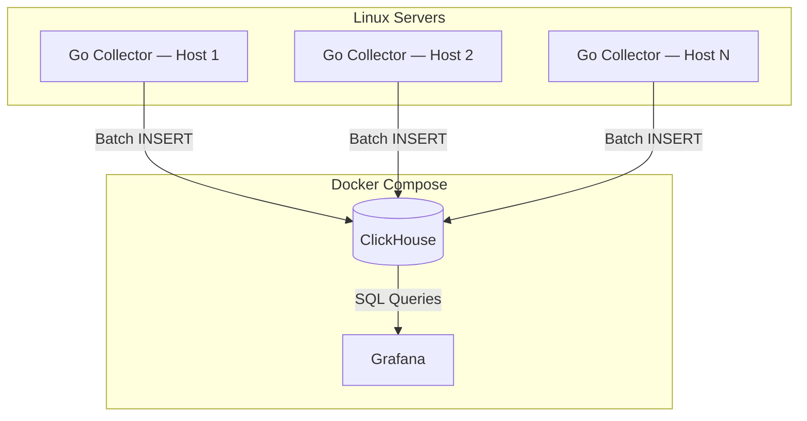

# ATSYS — Automated System Monitoring

ATSYS — система мониторинга ресурсов Linux-серверов, разработанная на Go с использованием ClickHouse для хранения метрик и Grafana для их визуализации.

Проект предназначен для автоматизированного сбора, хранения и анализа системных метрик одного или нескольких Linux-хостов.

## 1. О проекте

### Архитектура

Система состоит из трёх основных компонентов:

- **Collector (Go)** — сбор системных метрик непосредственно с Linux-хоста.
- **ClickHouse** — хранение исторических данных и выполнение аналитических запросов.
- **Grafana** — визуализация метрик и мониторинг состояния серверов.



Сборщики работают непосредственно на отслеживаемых Linux-хостах и передают данные в централизованную базу ClickHouse.

ClickHouse и Grafana разворачиваются с использованием Docker Compose.

### Собираемые метрики

| Категория | Метрики |
|---|---|
| CPU | User, System, Idle, Steal |
| RAM | Total, Used, Free, Available |
| Disk | Использованное и свободное пространство, процент заполнения |
| Processes | Общее количество процессов, Running, Sleeping, Zombie, Stopped |
| System | Hostname, Uptime |

Метрики CPU рассчитываются на основании данных `/proc/stat`.

Информация об оперативной памяти, дисковом пространстве и состоянии хоста получается с использованием библиотеки `gopsutil`.

Информация о процессах собирается непосредственно из `/proc`.

> **Примечание:** SQL-схема также предусматривает поля для сетевых метрик и утилизации диска, однако их сбор в текущей реализации Collector ещё не реализован.

### Особенности реализации

#### Асинхронная обработка данных

Сбор и отправка метрик реализованы в отдельных goroutine, взаимодействующих через Go channels.

Это позволяет разделить получение системной информации и запись данных в ClickHouse.

#### Пакетная загрузка

Метрики накапливаются в буфере и отправляются в ClickHouse пакетами с использованием `PrepareBatch`.

Размер пакета настраивается через переменную окружения `BATCH_SIZE`.

#### Оптимизация хранения

Для хранения используется таблица ClickHouse с движком `MergeTree`.

Реализованы:

- Партиционирование по месяцам.
- Сортировка по hostname и времени сбора.
- Специализированные кодеки сжатия для различных типов метрик.
- Автоматическое удаление данных старше 60 дней с помощью TTL.

#### Поддержка нескольких хостов

Каждая запись содержит hostname сервера, с которого были собраны метрики.

Это позволяет хранить данные нескольких серверов в одной таблице и фильтровать их в Grafana.

#### Автоматизация сборки

Для Collector настроены GitHub Actions workflows, которые выполняют:

- Статический анализ кода с помощью `go vet`.
- Сборку исполняемых файлов для Ubuntu и Arch Linux.
- Формирование SHA-256 checksums.
- Публикацию бинарных файлов в GitHub Releases при изменении кода сборщика.

Для Arch Linux используется self-hosted GitHub Actions runner.

### Технологический стек

| Технология | Назначение |
|---|---|
| Go | Разработка Collector |
| gopsutil | Получение системных метрик |
| ClickHouse | Хранение и аналитическая обработка данных |
| Grafana | Визуализация и мониторинг |
| Docker / Docker Compose | Развёртывание инфраструктуры |
| SQL | Создание таблиц, пользователей и управление доступом |
| Bash | Автоматизация конфигурации и инициализации |
| GitHub Actions | CI/CD и публикация релизов |
| systemd | Управление жизненным циклом Collector |

---

## 2. Установка

На текущем этапе развёртывание выполняется в несколько шагов.

Для запуска необходимо отдельно настроить инфраструктуру мониторинга и установить Collector на отслеживаемые серверы.

### 2.1. Требования

**Для сервера мониторинга:**

- Linux.
- Docker Engine.
- Docker Compose.
- Git.
- `envsubst` (пакет `gettext-base` в Ubuntu).
- Доступ к сети для загрузки Docker-образов и плагинов Grafana.

**Для отслеживаемых серверов:**

- Linux с файловой системой `/proc`.
- Go 1.26.5 для сборки из исходного кода либо готовый бинарный файл.
- Сетевой доступ к ClickHouse.

### 2.2. Клонирование репозитория

```bash
git clone https://github.com/tmshnko/atsys.git
cd atsys
```

### 2.3. Настройка переменных окружения

В корневой директории проекта создайте файл `.env`:

```bash
touch .env
```

Добавьте необходимые переменные окружения:

```dotenv
# ClickHouse
DB_NAME=system_stats
DB_USER=atsys
DB_PSWD=your_strong_password

CH_HOST=localhost
CH_PORT=9000

# Grafana
GF_SECURITY_ADMIN_USER=admin
GF_SECURITY_ADMIN_PASSWORD=your_grafana_password

GF_INSTALL_PLUGINS=grafana-clickhouse-datasource

# Read-only user for Grafana
GRAFANA_CH_USER=grafana_basic_reader
GRAFANA_CH_PASSWORD=your_reader_password

# Collector
COLLECT_TIMER=10
BATCH_SIZE=30
```

Описание переменных:

| Переменная | Описание |
|---|---|
| `DB_NAME` | Название базы данных ClickHouse |
| `DB_USER` | Пользователь ClickHouse для записи метрик |
| `DB_PSWD` | Пароль пользователя ClickHouse |
| `CH_HOST` | Адрес сервера ClickHouse |
| `CH_PORT` | Native TCP-порт ClickHouse |
| `GF_SECURITY_ADMIN_USER` | Администратор Grafana |
| `GF_SECURITY_ADMIN_PASSWORD` | Пароль администратора Grafana |
| `GF_INSTALL_PLUGINS` | Плагины Grafana для автоматической установки |
| `GRAFANA_CH_USER` | Пользователь ClickHouse для Grafana |
| `GRAFANA_CH_PASSWORD` | Пароль пользователя Grafana |
| `COLLECT_TIMER` | Интервал сбора метрик в секундах |
| `BATCH_SIZE` | Количество записей в одном пакете отправки |

Для локальной установки ClickHouse используется `CH_HOST=localhost`.

Если Collector работает на другом сервере, необходимо указать IP-адрес или DNS-имя сервера ClickHouse.

### 2.4. Подготовка SQL-скриптов

Для подстановки переменных окружения выполните:

```bash
bash scripts/create_grafana_user.sh
```

Скрипт создаст файл:

```text
sql/sys_metrics/002_add_grafana_user.sql
```

Этот файл используется при инициализации ClickHouse.

Пользователь Grafana имеет права `SELECT` на таблицы указанной базы данных. Для него также предусмотрен профиль настроек с ограничением на выполнение операций изменения данных.

### 2.5. Запуск ClickHouse и Grafana

Инфраструктура описана в `docker-compose.yml`.

Перед первым запуском необходимо проверить путь к SQL-скриптам в `scripts/clickhouse_init.sh`.

После подготовки конфигурации запустите:

```bash
docker compose up -d
```

Docker Compose создаст три сервиса:

| Сервис | Назначение |
|---|---|
| `clickhouse` | Основная база данных |
| `clickhouse-init` | Выполнение SQL-скриптов инициализации |
| `grafana` | Веб-интерфейс мониторинга |

**Порядок запуска:**

1. Запускается контейнер ClickHouse.
2. Docker ожидает успешного прохождения healthcheck.
3. Запускается `clickhouse-init`, который выполняет SQL-скрипты.
4. После успешного завершения инициализации запускается Grafana.

Состояние контейнеров можно проверить командой:

```bash
docker compose ps -a
```

Проверить логи:

```bash
docker compose logs -f
```

После завершения инициализации контейнер `clickhouse-init` должен завершиться с кодом `0`.

Если инициализация завершилась с ошибкой:

```bash
docker compose logs clickhouse-init
```

### 2.6. Доступ к Grafana

После запуска Grafana доступна по адресу:

```text
http://localhost:3000
```

Для входа используйте:

- Логин: значение `GF_SECURITY_ADMIN_USER`.
- Пароль: значение `GF_SECURITY_ADMIN_PASSWORD`.

### 2.7. Установка Collector

Collector устанавливается непосредственно на Linux-сервер, метрики которого необходимо собирать.

#### Вариант 1. Сборка из исходного кода

Клонируйте репозиторий на целевой сервер:

```bash
git clone https://github.com/tmshnko/atsys.git
cd atsys
```

Соберите Collector:

```bash
go build -o collector ./cmd/collector
```

Настройте `.env`, указав параметры подключения к ClickHouse и параметры сбора метрик.

Пример:

```dotenv
DB_NAME=system_stats
DB_USER=atsys
DB_PSWD=your_strong_password

CH_HOST=192.168.1.100
CH_PORT=9000

COLLECT_TIMER=10
BATCH_SIZE=30
```

Запустите:

```bash
./collector
```

После запуска Collector будет собирать системные метрики и отправлять их в ClickHouse.

#### Вариант 2. Установка из GitHub Releases

Для Ubuntu и Arch Linux предусмотрена автоматическая сборка бинарных файлов.

Готовые версии доступны в разделе:

[GitHub Releases](https://github.com/tmshnko/atsys/releases)

После скачивания подходящего бинарного файла:

1. Переименуйте его в `collector` при необходимости.
2. Выдайте права на выполнение.
3. Создайте файл `.env` в рабочем каталоге.
4. Запустите Collector.

```bash
chmod +x collector
./collector
```

Сборка и публикация выполняются отдельными GitHub Actions workflows для Ubuntu и Arch Linux.

### 2.8. Настройка systemd

Для автоматического запуска Collector при загрузке Linux предусмотрен пример systemd unit-файла:

```text
service.example
```

Пример предполагает следующую структуру:

```text
/opt/atsys_collector/
├── collector
└── .env
```

Создайте системного пользователя для запуска Collector:

```bash
sudo useradd --system --no-create-home --shell /usr/sbin/nologin metrics
```

Создайте директорию и разместите в ней бинарный файл и `.env`:

```bash
sudo mkdir -p /opt/atsys_collector
```

Скопируйте и настройте service-файл:

```bash
sudo cp service.example /etc/systemd/system/atsys_collector.service
```

Убедитесь, что пользователь `metrics` имеет права на чтение `.env`, выполнение Collector и получение системных метрик.

Обновите конфигурацию systemd:

```bash
sudo systemctl daemon-reload
```

Включите автозапуск:

```bash
sudo systemctl enable --now atsys_collector
```

Проверка состояния:

```bash
sudo systemctl status atsys_collector
```

Просмотр логов:

```bash
sudo journalctl -u atsys_collector -f
```

При аварийном завершении Collector systemd автоматически перезапустит процесс.

### 2.9. Проверка поступления данных

После запуска Collector можно проверить наличие метрик в ClickHouse.

Подключитесь к контейнеру:

```bash
docker exec -it clickhouse clickhouse-client \
    --user atsys \
    --password
```

Выполните SQL-запрос:

```sql
SELECT
    host,
    count() AS records_count,
    min(time) AS first_record,
    max(time) AS last_record
FROM system_stats.sys_metrics
GROUP BY host
ORDER BY host;
```

Запрос покажет список серверов, количество полученных записей и временные границы собранных данных.

Для просмотра последних метрик:

```sql
SELECT *
FROM system_stats.sys_metrics
ORDER BY time DESC
LIMIT 10;
```

---

## 3. Дальнейшие планы

Проект находится в активной разработке. Планируется развитие функциональности и упрощение развёртывания системы.

### 3.1. Автоматизация установки

**Приоритет: высокий**

Разработка единого установочного скрипта для развёртывания системы одной командой.

Планируется автоматизировать:

- Проверку необходимых зависимостей.
- Создание и проверку конфигурации.
- Подготовку SQL-скриптов.
- Создание базы данных, таблиц и пользователей.
- Запуск ClickHouse и Grafana.
- Проверку готовности сервисов.
- Установку Collector.
- Настройку systemd и автоматического запуска.

Цель — минимизировать количество ручных действий при установке системы на новый сервер.

### 3.3. Расширение набора метрик

Планируется реализовать сбор дополнительных системных показателей:

- Скорость получения и передачи данных по сети.
- Утилизация дисковых устройств.
- Дополнительные показатели загрузки CPU.
- Детализация использования ресурсов отдельными процессами.
- IP адрес сервера

### 3.3. Развитие мониторинга

Планируется:

- Добавление новых графиков и дашбордов.
- Настройка уведомлений о критических значениях метрик.
- Улучшение фильтрации по серверам.
- Добавление дневных / часовыв витрин для долгосрочного мониторинга.
